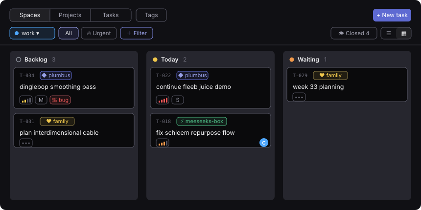
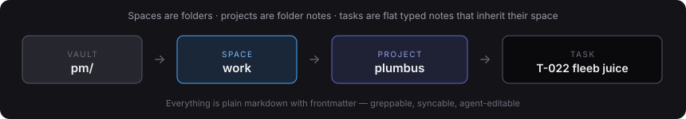

# Task Board

**Linear-style task management for Obsidian — spaces, projects, tasks, and tags, all stored as plain markdown you own.**

No database. No lock-in. Every task is a note with frontmatter; every project is a folder; every space is a folder level. The plugin is just a fast, keyboard-light UI over files that stay greppable, git-syncable, and editable by humans and AI agents alike.



## The hierarchy



```
pm/                                ← root folder (configurable)
├── spaces/
│   ├── work.md                    ← type: space · icon · color
│   └── personal.md
├── projects/
│   ├── active/
│   │   └── work/                  ← space folder (structural, can't dangle)
│   │       └── plumbus/
│   │           ├── plumbus.md     ← folder note: type: project · icon · color
│   │           └── …scratch notes ← projects are loose braindump folders
│   └── inactive/                  ← archived projects (plugin moves folders)
├── tasks/
│   ├── active/                    ← flat: tasks derive space via their project
│   └── inactive/                  ← done / cancelled / deleted (soft delete)
├── tags.md                        ← tag registry: name · icon · color
└── attachments/
```

A task's frontmatter is the whole record:

```yaml
id: T-022
type: task
status: today          # agent-inbox · backlog · this-week · today · waiting · done · cancelled
priority: P1           # P0–P3, rendered as Linear-style colored bars
project: plumbus       # mandatory — the container; space is inherited from it
size: S                # XS–XL
tags: [bug]
assignee: me           # free string — agents can be assignees too
origin: human          # human | ai
due:
created: 2026-08-12    # stamped on create
started: 2026-08-13    # stamped on first move to Today
completed:             # stamped on Done, cleared on reopen
```

## What you get

- **Board & list views** — kanban lanes or a grouped list, one toggle, same filters. Mobile opens centered on Today.
- **Spaces** — Linear's "team" layer. A switcher scopes every view; projects group under space headers; moving a project between spaces is a folder move and every task follows.
- **Projects** — folder notes with icon + color; overview table with open/done/% per project; per-project detail view with its tasks and a pre-scoped quick-add.
- **Tags** — a registry with icons, colors, and usage counts; rename or delete a tag across every task in one action; drift (tags used but unregistered) is surfaced, not hidden.
- **Filters & saved views** — Linear semantics (OR within a field, AND across fields) over space/project/tags/priority/size/status/assignee/origin, saveable as named header pills with icons.
- **Task notes become task pages** — opening a task shows a banner with breadcrumb navigation (space › project › id) and live-editing pills for every field; the raw Properties list is hidden. Auto-stamped created/started/completed dates ride along read-only.
- **Lifecycle automation** — status drives everything: moving to Done/Cancelled stamps dates and archives the file (links survive); delete is a soft delete (`status: deleted`, kept in `inactive/`); reopening restores automatically.
- **Structure enforced by code** — creating/renaming/archiving spaces, projects, and tags goes through dialogs that keep folder = note = slug invariants; malformed structures get a one-click "fix" button.
- **Agent-ready** — everything is frontmatter on markdown. An AI agent with file access can triage the `agent-inbox` lane, take `assignee: <agent>` tasks, and set `origin: ai` on tasks it creates.

## Install

Not yet in the community registry. Until then:

1. **Manual**: download `main.js`, `manifest.json` and `styles.css` from the [latest release](https://github.com/HaraldTR/task-board/releases/latest) into `<vault>/.obsidian/plugins/task-board/`, then enable it in Settings → Community plugins.
2. **BRAT**: add `HaraldTR/task-board` in the [BRAT](https://github.com/TfTHacker/obsidian42-brat) plugin to track releases automatically.

On first run, set the **root folder** in Settings → Task Board (defaults to `pm/`), then create your first space from the board header. Works on desktop and mobile.

## Settings

| Setting | Default | Notes |
|---|---|---|
| Root folder | `pm` | All system folders live under it |
| Task ID prefix | `T` | New tasks number `T-001, T-002, …` |
| Default assignee | `me` | Cards show avatars only for non-default assignees |
| Open board on launch | mobile only | Never / mobile / always |

## Development

```bash
npm install
npm run ship        # build + copy into your vault, then reload Obsidian
```

`ship` finds the vault via the `OBSIDIAN_VAULT` env var, a `.vault-path` file in the repo root (gitignored), or `../../` when the repo lives inside a vault. `npm run check` type-checks.

Releases are cut by CI: bump the version in `manifest.json`, `package.json` and
`versions.json`, then push a matching tag (no `v` prefix) — the workflow
type-checks, builds, and publishes `main.js`, `manifest.json` and `styles.css`
as release assets.

```bash
git tag 0.25.0 && git push origin 0.25.0
```

Design history lives in [`docs/`](docs/) — including the [spaces design doc](docs/2026-08-13-spaces-design.html) with full UI mockups.

## License

[MIT](LICENSE)
